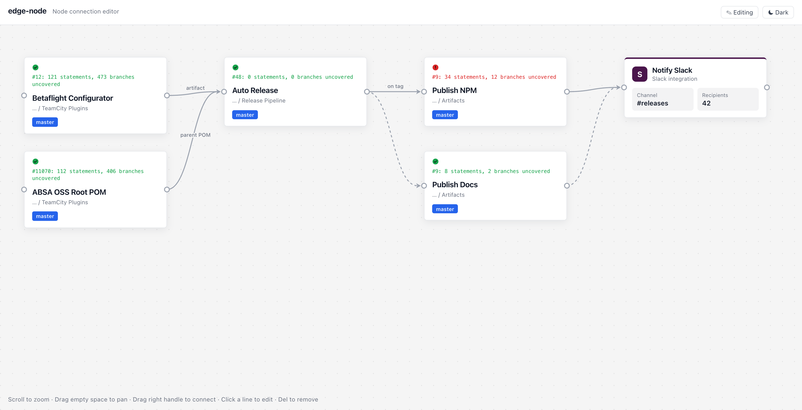
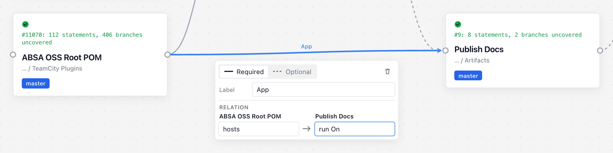
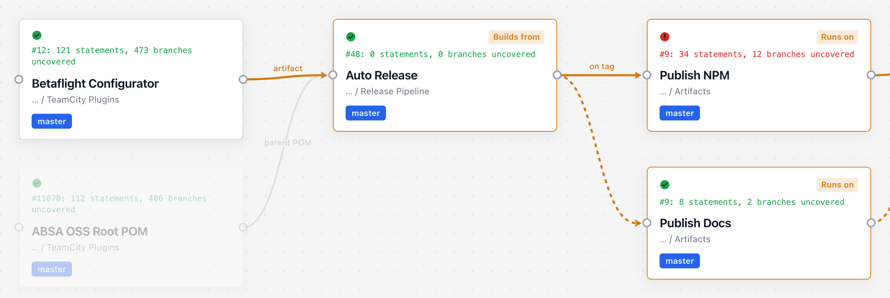
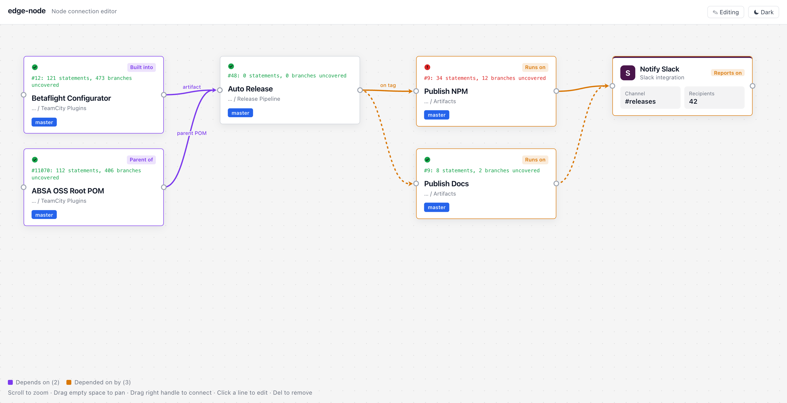
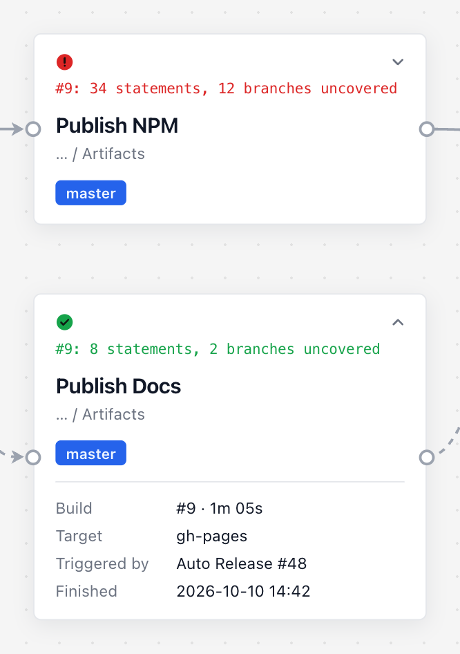
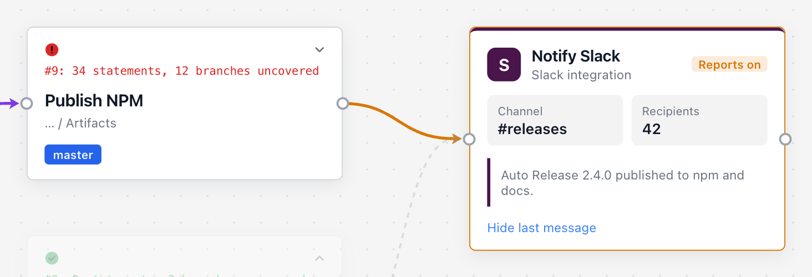
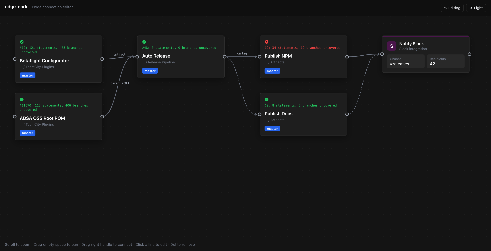

# edge-node

외부 그래프 라이브러리 없이 만든 React **노드 연결 에디터**입니다.
HTML 카드 노드와 SVG 연결선으로 왼쪽 → 오른쪽 파이프라인 형태의 의존 관계(DAG)를 보여주고 편집합니다.



- 연결 방향(화살표), 선 모양(실선/점선), 라벨, **양방향 관계** 표시
- 노드에 마우스를 올리면 의존 사슬 전체를 강조하고 각 노드의 관계를 칩으로 표시
- 편집 모드(이동·연결·수정·삭제) / 보기 모드(세부정보 펼치기) 전환
- 변경 시 콜백(`onConnect` 등)으로 API 저장, 실패하면 자동 되돌리기
- 라이트/다크 모드, 테마, 카드 전체 커스텀(`renderNode`)

---

## 목차

1. [설치](#설치)
2. [빠른 시작](#빠른-시작)
3. [데이터 구조: 노드와 연결선](#데이터-구조-노드와-연결선)
4. [편집 모드와 보기 모드](#편집-모드와-보기-모드)
5. [연결 만들기: 선 모양 · 라벨 · 관계](#연결-만들기-선-모양--라벨--관계)
6. [호버로 관계 보기](#호버로-관계-보기)
7. [노드 세부정보](#노드-세부정보)
8. [변경 저장 (API 연동)](#변경-저장-api-연동)
9. [카드 직접 그리기 (`renderNode`)](#카드-직접-그리기-rendernode)
10. [라이트/다크 모드와 테마](#라이트다크-모드와-테마)
11. [API 요약](#api-요약)
12. [개발](#개발)

---

## 설치

```bash
npm install edge-node
```

React 18 이상이 필요합니다(`react`, `react-dom`은 peer dependency). 스타일 파일을 한 번 import 해야 카드 모양이 나옵니다.

```ts
import 'edge-node/style.css'
```

## 빠른 시작

```tsx
import { createInitialState, GraphCanvas, layoutColumns } from 'edge-node'
import 'edge-node/style.css'

const nodes = layoutColumns([
  { id: 'a', column: 0, row: 0, data: { title: 'Build', status: 'success' } },
  { id: 'b', column: 1, row: 0, data: { title: 'Deploy', status: 'idle' } },
])

const initialState = createInitialState(nodes, [
  { source: 'a', target: 'b', kind: 'required', label: 'App', relation: 'run On', inverseRelation: 'hosts' },
])

export function Pipeline() {
  return (
    <div style={{ height: 600 }}>
      <GraphCanvas initialState={initialState} editable colorMode="system" />
    </div>
  )
}
```

- 캔버스는 부모 크기를 꽉 채웁니다. **감싸는 요소에 높이**를 꼭 주세요.
- `initialState`는 처음 한 번만 읽습니다. 이후 변경은 콜백으로 받습니다([변경 저장](#변경-저장-api-연동)).

## 데이터 구조: 노드와 연결선

노드와 연결선은 **따로** 넘깁니다. 노드 데이터 안에는 연결 정보가 없고,
연결선 목록이 `createInitialState(nodes, edges)`의 두 번째 인자입니다.

### 노드

```ts
layoutColumns([
  {
    id: 'betaflight',
    column: 0,                       // 몇 번째 열 (왼쪽부터)
    row: 0,                          // 열 안에서 몇 번째 (위부터)
    // position: { x: 120, y: 80 },  // 저장된 위치가 있으면 column/row 대신 사용
    // width: 300,                   // 기본 300
    data: {
      title: 'Betaflight Configurator',              // 필수. 굵은 제목
      status: 'success',                             // 필수. 'success' | 'error' | 'idle' → 왼쪽 위 아이콘
      stats: '#12: 121 statements, 473 branches uncovered', // 아이콘 아래 한 줄 (status 색)
      subtitle: '... / TeamCity Plugins',            // 제목 아래 회색 글씨
      badge: 'master',                               // 파란 칩
      details: [                                     // 보기 모드에서 펼치면 보이는 목록
        { label: 'Build', value: '#12 · 4m 12s' },
        { label: 'Commit', value: 'a3f9c21 — Fix serial port reconnect' },
      ],
    },
  },
])
```

| 필드 | 카드에서의 위치 |
|------|----------------|
| `status` | 왼쪽 위 아이콘 (초록 체크 / 빨간 느낌표 / 회색 원) |
| `stats` | 아이콘 아래 고정폭 글씨, 색은 `status`를 따름 |
| `title` | 굵은 제목 |
| `subtitle` | 제목 아래 회색 글씨 |
| `badge` | 파란 칩 |
| `details` | 펼쳤을 때 아래쪽 라벨/값 목록. 없으면 펼치기 버튼이 안 보임 |
| (오른쪽 위) | 호버 시 관계 칩, 보기 모드의 펼치기 버튼 ⌄ |

빈 필드는 화면에서 자리 자체가 사라집니다. 카드 높이는 내용에 맞게 자동으로 정해집니다.

### 연결선

```ts
type GraphEdgeInput = {
  source: string            // 출발 노드 id (카드 오른쪽 핸들)
  target: string            // 도착 노드 id (카드 왼쪽 핸들). target이 source에 의존
  kind?: 'required' | 'optional' // 선 모양: 실선(기본) / 점선
  label?: string            // 선 가운데 글자
  relation?: string         // target의 관계: "target <relation> source"
  inverseRelation?: string  // source의 관계: "source <inverseRelation> target"
}
```

연결선 `id`는 자동으로 `` `${source}->${target}` ``가 됩니다. 같은 방향의 중복 연결과
**순환(A → B → A)은 만들 수 없습니다**(필요하면 `allowCycles`).

## 편집 모드와 보기 모드

```tsx
<GraphCanvas initialState={initialState} editable />          // 편집 모드
<GraphCanvas initialState={initialState} editable={false} />  // 보기 모드 (기본값)
```

| 동작 | 편집 모드 (`editable`) | 보기 모드 (기본값) |
|------|-----------------------|-------------------|
| 노드 클릭 | 선택 | 세부정보 펼치기 / 접기 |
| 노드 드래그 | 위치 이동 | — |
| 연결 만들기 | 오른쪽 핸들을 끌어 다른 노드의 왼쪽 핸들에 놓기 | — |
| 연결선 클릭 | 편집 창 열기 (선 모양·라벨·관계·삭제) | — |
| 삭제 | 선택 후 `Delete` / `Backspace`, 또는 편집 창 휴지통 | — |
| 선택 해제 | 빈 곳 클릭 또는 `Esc` | — |
| 마우스 올리기 | 의존 사슬 강조 + 관계 칩 | 같음 |
| 화면 이동 / 확대 | 빈 곳 드래그 / 스크롤 | 같음 |

- 편집 → 보기로 바꾸면 열려 있던 연결선 편집 창이 닫히면서 그때까지의 변경이 확정됩니다.
- 보기 → 편집으로 바꾸면 펼쳐져 있던 세부정보가 접힙니다.

## 연결 만들기: 선 모양 · 라벨 · 관계

편집 모드에서 a의 오른쪽 핸들을 b의 왼쪽 핸들로 끌어 놓으면 편집 창이 뜹니다.
선 모양을 고르고, 라벨과 **양쪽 관계**를 입력한 뒤 `Enter`(또는 `Esc`, 다른 곳 클릭)로 닫으면 저장됩니다.



| 입력 | 저장되는 필드 | 화면 |
|------|--------------|------|
| Required / Optional | `kind` | 실선 / 점선 |
| Label | `label` | 선 가운데 글자 (위 그림의 `App`) |
| Relation 왼쪽 칸 (출발 노드 이름 아래) | `inverseRelation` | b에 호버하면 **a 카드**에 표시 |
| Relation 오른쪽 칸 (도착 노드 이름 아래) | `relation` | a에 호버하면 **b 카드**에 표시 |

관계 칸은 그래프와 같은 방향으로 놓입니다. 왼쪽이 출발 노드, 오른쪽이 도착 노드이고,
각 칸 위에 적힌 노드의 카드에 그 관계가 표시됩니다. 위 그림을 데이터로 쓰면 다음과 같습니다.

```ts
{ source: 'absa-root', target: 'publish-docs', kind: 'required', label: 'App', inverseRelation: 'hosts', relation: 'run On' }
```

이미 있는 선은 클릭하면 같은 편집 창으로 고칠 수 있습니다.

## 호버로 관계 보기

노드에 마우스를 올리면 그 노드와 이어진 **의존 사슬 전체**가 강조되고 나머지는 흐려집니다.

- 보라색: 호버한 노드가 의존하는 쪽(왼쪽, upstream)
- 주황색: 호버한 노드에 의존하는 쪽(오른쪽, downstream)
- 왼쪽 아래 범례에 양쪽 개수가 표시됩니다.

각 카드 오른쪽 위 칩에는 **그 노드가 사슬에서 바로 앞 노드에 대해 갖는 관계**가 나옵니다.
`a → b → c`에서 a에 호버하면 b에는 a와의 관계, c에는 b와의 관계가 나옵니다.



위 그림은 Betaflight(a)에 호버한 모습입니다.

- Auto Release(b): `Builds from` (Betaflight와의 관계)
- Publish NPM / Publish Docs(c): `Runs on` (Auto Release와의 관계)

여러 경로로 이어져 관계가 서로 다르면 쉼표로 이어서 표시합니다(같은 관계는 한 번만).
관계를 입력하지 않은 연결은 칩 없이 색만 바뀝니다.

가운데 노드에 호버하면 양쪽이 함께 보입니다. 왼쪽 노드에는 `inverseRelation`, 오른쪽 노드에는 `relation`이 표시됩니다.



## 노드 세부정보

보기 모드에서 노드의 내용 부분을 클릭하거나 오른쪽 위 ⌄ 버튼을 누르면 `data.details`가 펼쳐지고, 다시 누르면 접힙니다.
드래그는 클릭으로 치지 않습니다.



API에서 조회해야 하면 `renderNodeDetails`로 직접 그립니다. 펼칠 때만 렌더링되므로,
반환한 컴포넌트가 마운트될 때 데이터를 불러오면 됩니다. 이 prop을 주면 모든 노드를 펼칠 수 있습니다.

```tsx
function NodeDetails({ id }: { id: string }) {
  const [detail, setDetail] = useState<Record<string, string> | null>(null)
  useEffect(() => {
    fetch(`/api/nodes/${id}`).then((r) => r.json()).then(setDetail)
  }, [id])
  if (!detail) return <span>Loading…</span>
  return <pre>{JSON.stringify(detail, null, 2)}</pre>
}

<GraphCanvas initialState={initialState} renderNodeDetails={(node) => <NodeDetails id={node.id} />} />
```

## 변경 저장 (API 연동)

화면에서 바뀐 내용은 콜백으로 받아 저장합니다. 변경은 화면에 먼저 반영되고,
콜백이 `false`를 반환하거나 Promise가 reject되면 **자동으로 되돌립니다**
(연결 → 제거, 수정 → 이전 값, 삭제 → 복원, 이동 → 원래 위치). 처리 중인 연결선은 반투명으로 보입니다.

| 콜백 | 호출 시점 |
|------|-----------|
| `onConnect(edge)` | 새 연결의 편집 창이 닫힐 때 한 번. 입력한 선 모양·라벨·관계가 담겨 있음. 닫기 전에 지우면 호출 안 됨 |
| `onEdgeUpdate(edge, previous)` | 기존 연결의 편집 창이 닫힐 때, 실제로 바뀐 게 있을 때만 한 번 |
| `onEdgeDelete(edge)` | 확정된 연결이 지워질 때. 노드를 지우면 붙어 있던 연결마다 한 번씩 |
| `onNodeMove(node, previous)` | 노드를 드래그해서 놓을 때 한 번(드래그 중에는 안 불림). `node.position`이 새 위치 |

```tsx
const json = (method: string, body?: unknown) => ({
  method,
  headers: { 'Content-Type': 'application/json' },
  body: body === undefined ? undefined : JSON.stringify(body),
})

<GraphCanvas
  initialState={initialState}
  editable
  onConnect={async (edge) => (await fetch('/api/edges', json('POST', edge))).ok}
  onEdgeUpdate={async (edge) =>
    (await fetch(`/api/edges/${encodeURIComponent(edge.id)}`, json('PATCH', edge))).ok}
  onEdgeDelete={async (edge) =>
    (await fetch(`/api/edges/${encodeURIComponent(edge.id)}`, json('DELETE'))).ok}
  onNodeMove={async (node) =>
    (await fetch(`/api/nodes/${node.id}`, json('PATCH', { position: node.position }))).ok}
/>
```

### 저장한 위치로 불러오기

`layoutColumns`에 `position`을 넘기면 열/행 자동 배치 대신 그 위치를 씁니다. 저장된 위치가 없는 노드만 자동 배치됩니다.

```ts
const saved = await fetch('/api/nodes').then((r) => r.json()) // [{ id, position: { x, y } }, ...]
const positions = new Map(saved.map((n) => [n.id, n.position]))

const nodes = layoutColumns(inputs.map((input) => ({ ...input, position: positions.get(input.id) })))
```

## 카드 직접 그리기 (`renderNode`)

`renderNode`를 주면 카드 안쪽을 전부 직접 그릴 수 있고, 노드 데이터 모양도 자유롭게 정할 수 있습니다.
라이브러리는 카드 테두리(위치, 배경, 선택·호버·흐림 상태), 연결 핸들, 드래그, 클릭으로 펼치기만 맡습니다.
아래 그림의 오른쪽 Slack 카드가 `renderNode`로 그린 카드입니다.



```tsx
import { createInitialState, GraphCanvas, layoutColumns, type RenderNode } from 'edge-node'

type ServiceData = { name: string; owner: string; logs: string[] }

const nodes = layoutColumns<ServiceData>([
  { id: 'api', column: 0, row: 0, data: { name: 'API', owner: 'core', logs: ['deployed v2'] } },
])

const renderNode: RenderNode<ServiceData> = (node, ctx) => (
  <div style={{ padding: 16 }}>
    <strong>{node.data.name}</strong> · {node.data.owner}
    {ctx.relation ? <span className="chip">{ctx.relation}</span> : null}
    {ctx.expanded ? <ul>{node.data.logs.map((l) => <li key={l}>{l}</li>)}</ul> : null}
    {!ctx.editable ? (
      <button onClick={ctx.toggleExpanded}>{ctx.expanded ? '접기' : '로그 보기'}</button>
    ) : null}
  </div>
)

<GraphCanvas initialState={createInitialState(nodes, [])} renderNode={renderNode} />
```

`ctx`(`NodeRenderContext`)로 넘어오는 값:

| 값 | 의미 |
|----|------|
| `editable` | 편집 모드 여부 |
| `selected` | 선택됨 (편집 모드) |
| `role` | 호버 중인 노드 기준 위치: `'focus'` / `'upstream'` / `'downstream'` / `undefined` |
| `relation` | 호버 시 이 카드에 표시할 관계 문구 ([호버로 관계 보기](#호버로-관계-보기)와 같은 규칙) |
| `dimmed` | 강조 범위 밖이라 흐리게 표시되는 중 |
| `expanded` / `toggleExpanded()` | 펼침 상태와 전환 함수 (보기 모드) |

- 노드마다 다르게 그리려면 기본 카드를 쓸 노드에서 `undefined`를 반환하세요.
- 커스텀 카드는 안쪽 여백이 0이라 여백을 직접 줘야 합니다.
- 카드 안의 `button`, `a`, `input` 등이나 `data-no-toggle` 속성이 있는 요소를 클릭해도 펼치기가 바뀌지 않습니다.
- 데이터가 기본 `NodeData` 모양이 아니면 `layoutColumns<MyData>(...)`처럼 타입을 지정하세요.

## 라이트/다크 모드와 테마



```tsx
<GraphCanvas initialState={initialState} colorMode="dark" />   // 'dark'(기본) | 'light' | 'system'
```

사용자가 고른 모드를 기억하려면 `useColorMode`를 씁니다.

```tsx
const { resolvedMode, toggle } = useColorMode({ storageKey: 'my-app:theme' }) // 기본은 OS 설정
<button onClick={toggle}>{resolvedMode === 'dark' ? 'Light' : 'Dark'}</button>
<GraphCanvas initialState={initialState} colorMode={resolvedMode} />
```

색을 바꾸려면 `theme`에 바꿀 값만 넘기면 됩니다. 나머지는 `colorMode` 프리셋 값을 유지합니다.

```tsx
<GraphCanvas
  initialState={initialState}
  theme={{
    background: '#0b1220',
    gridColor: 'transparent',
    node: { background: '#111827', border: '#374151', radius: 10 },
    edge: { color: '#64748b', selectedColor: '#38bdf8', arrowSize: 10 },
    dependency: { upstreamColor: '#a78bfa', downstreamColor: '#f59e0b', dimOpacity: 0.2 },
  }}
/>
```

<details>
<summary><code>GraphTheme</code> 전체 필드</summary>

```ts
type GraphTheme = {
  background?: string
  gridColor?: string          // 'transparent'면 점 그리드 숨김
  gridSize?: number
  node?: {
    background?: string; border?: string; borderHover?: string; borderSelected?: string
    title?: string; subtitle?: string; shadow?: string; radius?: number
    handle?: string; handleActive?: string; badgeBackground?: string; badgeText?: string
    statusSuccess?: string; statusError?: string; statusIdle?: string
  }
  edge?: {
    color?: string; hoverColor?: string; selectedColor?: string
    width?: number; hoverWidth?: number; selectedWidth?: number
    hitWidth?: number         // 클릭 인식 폭 (화면 px)
    draftColor?: string; draftWidth?: number; draftDash?: string // 연결 드래그 중 임시선
    arrowSize?: number        // 화살표 길이 (화면 px), 0이면 숨김
    optionalDash?: string     // 점선(optional) 패턴
    labelColor?: string
  }
  hud?: { color?: string }    // 왼쪽 아래 안내 문구
  dependency?: {
    upstreamColor?: string    // 의존하는 쪽 강조색
    downstreamColor?: string  // 의존받는 쪽 강조색
    dimOpacity?: number       // 강조 범위 밖 투명도
  }
}
```

</details>

## API 요약

### `<GraphCanvas>` props

| prop | 타입 | 설명 |
|------|------|------|
| `initialState` | `GraphState` | `createInitialState(nodes, edges)` 결과. 필수 |
| `editable` | `boolean` | 편집 모드. 기본 `false`(보기 모드) |
| `colorMode` | `'dark' \| 'light' \| 'system'` | 색 프리셋. 기본 `'dark'` |
| `theme` | `GraphTheme` | 프리셋 위에 덮어쓸 색·크기 |
| `allowCycles` | `boolean` | 순환 연결 허용. 기본 `false` |
| `onConnect` / `onEdgeUpdate` / `onEdgeDelete` / `onNodeMove` | 콜백 | [변경 저장](#변경-저장-api-연동) |
| `renderNodeDetails` | `(node) => ReactNode` | 펼친 영역 내용 |
| `renderNode` | `(node, ctx) => ReactNode` | 카드 안쪽 전체 |

### 함수 · 훅

| 이름 | 설명 |
|------|------|
| `createInitialState(nodes, edges, viewport?)` | 초기 상태 생성 |
| `layoutColumns(inputs)` | 열/행으로 노드 위치 자동 배치 (`position`이 있으면 그 위치 사용) |
| `useColorMode(options?)` | `{ mode, resolvedMode, setMode, toggle }`, `storageKey`를 주면 저장 |
| `useSystemColorMode()` | OS 라이트/다크 설정 |
| `getUpstream` / `getDownstream(edges, id)` | 의존하는 / 의존받는 노드 id 집합 (간접 포함) |
| `wouldCreateCycle(edges, source, target)` | 연결 시 순환 여부 |
| `darkGraphTheme` / `lightGraphTheme` / `resolveGraphTheme` | 테마 프리셋과 병합 함수 |

## 개발

```bash
npm install
npm run dev
```

| 명령 | 설명 |
|------|------|
| `npm run dev` | 데모 개발 서버 |
| `npm run build` | 데모 빌드 (`dist-demo/`) |
| `npm run build:lib` | 라이브러리 빌드 (`dist/`: JS, 타입, `style.css`) |
| `npm run lint` | Oxlint |
| `npm run preview` | 데모 빌드 미리보기 |

```
src/
  graph/                  ← 라이브러리 (npm 배포 대상)
    components/           GraphCanvas, GraphNode, GraphEdge, EdgeEditor, ConnectionLine
    hooks/                useViewport, useConnectionDrag, useColorMode, useGraphPersistence
    dependencies.ts       의존 사슬 계산, 순환 검사, 관계 칩
    types.ts / store.ts   데이터 모델, reducer
    geometry.ts           핸들 좌표, 베지어 곡선, 화살표
    layout.ts             열 배치
    theme.ts              테마 프리셋 · CSS 변수
    graph.css             스타일
  App.tsx, demoGraph.ts   데모 앱과 샘플 데이터
  IntegrationCard.tsx     renderNode 데모 카드
docs/images/              README 스크린샷
```

### 아직 없는 것

미니맵, undo/redo, 그리드 스냅, 다중 선택, 위·아래 방향 연결, 노드 추가/삭제 콜백, 화면 안 문구 변경(현재 영어 고정)
